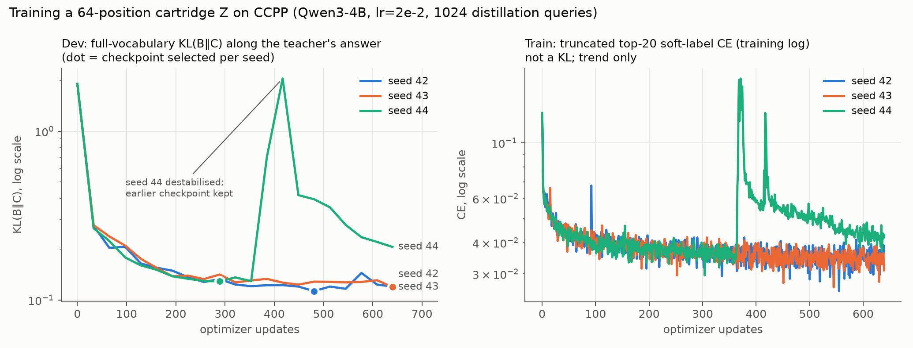
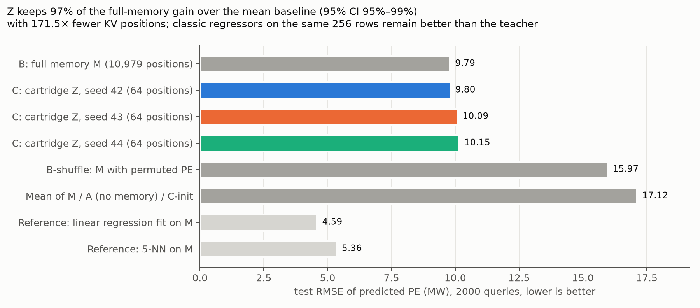

# CCPP 记忆压缩实验 · 第一轮结果（Qwen3-4B，自动生成）
## 1. 教师检查（tune 集 256 条；每个记忆长度 3 份随机抽样，均值）
| cond | n_rows | mem_tokens | parse_rate | rmse_mean | rmse_sd | mae_mean | mean_rmse | ols_rmse | knn5_rmse |
|---|---|---|---|---|---|---|---|---|---|
| B | 16 | 689.33 | 0.05 | 16.42 | 0.49 | 14.07 | 16.73 | 4.82 | 7.90 |
| B | 64 | 2747.33 | 1.00 | 10.17 | 1.98 | 7.78 | 16.56 | 4.36 | 6.10 |
| B | 128 | 5493.33 | 1.00 | 8.15 | 0.60 | 6.27 | 16.59 | 4.20 | 5.76 |
| B | 256 | 10980.00 | 1.00 | 8.39 | 0.99 | 6.20 | 16.49 | 4.13 | 5.23 |
| B | 512 | 21953.33 | 1.00 | 6.44 | 0.35 | 5.00 | 16.47 | 4.12 | 4.58 |
| B_shuffle | 16 | 689.33 | 0.03 | 16.71 | 0.25 | 14.45 | 16.73 | 4.82 | 7.90 |
| B_shuffle | 64 | 2747.33 | 1.00 | 22.17 | 2.52 | 18.84 | 16.56 | 4.36 | 6.10 |
| B_shuffle | 128 | 5493.33 | 1.00 | 21.29 | 0.97 | 17.29 | 16.59 | 4.20 | 5.76 |
| B_shuffle | 256 | 10980.00 | 1.00 | 19.35 | 4.37 | 15.69 | 16.49 | 4.13 | 5.23 |
| B_shuffle | 512 | 21953.33 | 1.00 | 19.13 | 2.98 | 15.58 | 16.47 | 4.12 | 4.58 |

预注册主记忆 r0_n256：B RMSE 9.50；相对 B-打乱 ΔRMSE -5.06 [95% CI -6.72, -3.51]。

A（无记忆）：16 词元内不输出数字；放宽到 384 词元后 100% 明确拒答，文中出现的数字是复述的输入特征（如 RH），不是预测。A 按无预测处理，RMSE 为记忆池均值回退（≈ 均值底线）。

## 2. 实现检查
- HF 前缀 KV 与整串前向：KL 均值 0.0065，argmax 一致 0.964；bf16 噪声底（fp32 vs bf16）KL 0.0074；crop 后重跑完全一致：True
- Cartridges(Flex) vs HF：k=64 初始化 KL 0.0026；完整 M KL 0.0123
- 存/读：冻结 1、可训练 63，数值一致 True（未打补丁会读成冻结 8）
- 原版 bf16 参数，lr=0.002：3 步中被舍入为 0 的更新比例 0.334–0.570
- 原版 bf16 参数，lr=0.02：3 步中被舍入为 0 的更新比例 0.012–0.118
- P4 fp32 主参数，lr=0.002：被舍入比例 ≤ 1.33e-05，前向 logits 最大差 0.0
- P4 fp32 主参数，lr=0.02：被舍入比例 ≤ 2.58e-06，前向 logits 最大差 0.0

## 3. 教师数据
- distill: n=1024，解析率 1.000，教师 RMSE 9.64，top-20 覆盖最小值 0.999998
- dev: n=256，解析率 1.000，教师 RMSE 9.52，top-20 覆盖最小值 0.999998

## 4. 训练与开发集选择（全词表 KL(B‖C)，沿教师答案路径）
| run | init_dev_kl | best_dev_kl | best_updates | best_dev_rmse | best_dev_absdiff_B | best_dev_parse |
|---|---|---|---|---|---|---|
| lr2e-2_s42 | 1.9077 | 0.1130 | 481 | 9.6164 | 1.5220 | 1.0000 |
| lr2e-2_s43 | 1.9077 | 0.1194 | 640 | 10.1942 | 1.8079 | 1.0000 |
| lr2e-2_s44 | 1.9077 | 0.1290 | 289 | 10.4944 | 1.8676 | 1.0000 |
| lr5e-3_s42 | 1.9077 | 0.1215 | 513 | 9.1592 | 1.5943 | 1.0000 |

选中学习率：2e-2

## 5. 测试集结果（2000 条；B 完整记忆 10,979 词元，C 为 k=64）
| cond | cache_positions | cache_MB | parse_rate | rmse_filled | mae_filled | abs_diff_vs_B | n_both_parsed | kl_B_X | top1_agree_B_X |
|---|---|---|---|---|---|---|---|---|---|
| A | 0 | 0.000 | — | — | — | — | — | 3.519 | 0.377 |
| B | 10979 | 1543.922 | 1.000 | 9.792 | 7.172 | 0.000 | 2000.000 | 0.000 | 1.000 |
| B_shuffle | 10979 | 1543.922 | 1.000 | 15.968 | 12.671 | 10.212 | 2000.000 | 0.621 | 0.633 |
| C_init | 64 | 9.000 | 0.000 | 17.121 | 14.855 | — | 0.000 | 1.886 | 0.406 |
| C_s42 | 64 | 9.000 | 1.000 | 9.801 | 7.132 | 1.621 | 2000.000 | 0.096 | 0.881 |
| C_s43 | 64 | 9.000 | 1.000 | 10.086 | 7.435 | 1.591 | 2000.000 | 0.095 | 0.879 |
| C_s44 | 64 | 9.000 | 1.000 | 10.154 | 7.485 | 1.777 | 2000.000 | 0.107 | 0.860 |

C-训练后（3 个种子）：RMSE 10.014 ± 0.188；MAE 7.351 ± 0.191；KL(B‖C) 0.0996 ± 0.0067；与 B 数字差 1.663 ± 0.100

压缩率（完整 M 词元数 ÷ k）：10979 / 64 = 171.5×

注：top1_agree_B_X 是沿 B 答案路径（teacher forcing）逐词元 argmax 一致率，包含几乎必然一致的“.”与结束符；整条答案与 B 完全相同的比例：C_s42 44.2%，C_s43 43.5%，C_s44 39.5%。

A（无记忆）test：不给出数值预测（长回答中 100% 明确拒答）；按均值回退 RMSE 17.120，MAE 14.914

传统方法（拟合同一份 256 行记忆）test：
- 均值底线：RMSE 17.121，MAE 14.855
- 线性回归 (OLS)：RMSE 4.587，MAE 3.688
- 5-NN：RMSE 5.356，MAE 4.210

## 6. 配对 bootstrap（测试集，按 qid 配对，5000 次，95% CI）
- RMSE(C_s42) − RMSE(B) = +0.009 [-0.206, +0.216]
- RMSE(C_s43) − RMSE(B) = +0.294 [+0.085, +0.503]
- RMSE(C_s44) − RMSE(B) = +0.362 [+0.145, +0.592]
- RMSE(C_avg3) − RMSE(B) = +0.221 [+0.049, +0.399]
- RMSE(C_avg3) − RMSE(B_shuffle) = -5.954 [-6.539, -5.368]
- RMSE(C_avg3) − RMSE(mean) = -7.107 [-7.423, -6.790]
- RMSE(B) − RMSE(mean) = -7.329 [-7.684, -6.976]
- RMSE(B) − RMSE(B_shuffle) = -6.176 [-6.778, -5.571]
- 恢复率 R = (RMSE_mean − RMSE_C) / (RMSE_mean − RMSE_B) = 97.0% [94.6%, 99.3%]（A 不给数字，以均值底线为无记忆参照）

## 7. 训练稳定性
- lr2e-2_s44 训练中途发散：第 417 次更新附近开发 KL 升至 2.05，训练结束时 0.206；按开发 KL 选到发散前第 289 次更新（0.129）

## 9. 信息来源对照：C 是在压缩 M，还是在学 1024 个教师伪标签？
不用任何记忆，只用 C 训练时同样的 1024 个 (X, 教师答案) 拟合传统回归器，在 test 2000 条上评估：

| 方法 | test_rmse_vs_truth | corr_with_B | mean_abs_diff_vs_B |
|---|---|---|---|
| OLS（教师伪标签） | 8.799 | 0.918 | 3.341 |
| 1-NN（教师伪标签） | 9.592 | 0.915 | 2.606 |
| 5-NN（教师伪标签） | 9.287 | 0.940 | 2.635 |
| OLS（真值标签，参照） | 4.586 | 0.884 | 6.163 |
| 1-NN（真值标签，参照） | 5.977 | 0.849 | 6.982 |
| 5-NN（真值标签，参照） | 4.741 | 0.880 | 6.114 |
| C（64 位置 Z，3 种子平均） | 10.014 | 0.953 | 1.663 |

结论：RMSE 层面，用同样伪标签的 OLS（8.80）已不差于 C 和 B，因此“保留 97% 收益”不能单独证明 C 压缩了 M；但 C 比这些回归器更贴近 B（相关 0.953 vs ≤0.940，数字差 1.66 vs ≥2.61 MW），说明它复现的是 B 的具体行为。

## 10. 主结论（建议写法）与解读限定

**主结论**：在 CCPP / Qwen3-4B / 单份 256 行记忆上，按开发集 KL 早停蒸馏得到的 64 位置前缀（KV 位置为完整记忆的 1/171.5），
在同分布测试查询上复现了 B 的大部分行为：test RMSE 10.01 ± 0.19（3 种子）对 B 9.79，略差且显著（+0.22 [0.05, 0.40]）；
相对均值底线的改进保留 97% [94.6%, 99.3%]（只含查询抽样的不确定性）。B 本身近似 1-NN 抄表（OLS 4.59），
且蒸馏查询与测试同分布，尚不能排除 C 只是从 1024 个伪标签学到了回归（见第 9 节）。

**限定语**（汇报时请保留）：
1. 单一设定：CCPP、Qwen3-4B、一份 256 行记忆（r0_n256，三份抽样中教师最弱的一份，未挑选）、k=64、1024 条蒸馏、贪心解码。
2. B 不是上限：B 与 1-NN 相关 0.85，约 57–61% 的预测恰为 M 中某个 PE；R=97% 衡量的是对一个弱教师的保真度。
3. 不参与选学习率的两个种子都显著差于 B（s43 +0.29，s44 +0.36）；s42 与 B 无差异（+0.01），但 s42 参与了学习率选择。
4. C-初始与 A 都不输出数字，两行实际是均值回退；KL(B‖C) 与 top-1 一致率沿 B 的贪心答案逐词元计算，整条答案与 B 完全相同只有 39–44%。
5. 学习率二选一的开发 KL 差（0.0085）小于种子间差（0.016）；lr=2e-2 下 s44 中途发散，靠早停选到发散前的 checkpoint。
6. 171.5× 是 KV 位置数之比（MiB 为理论值，未实测显存与延迟）；训练成本未计入（教师数据约 4 分钟，每个 run 约 15 分钟 H100）。
7. 实现为 Cartridges + 补丁 P1/P2/P4（fp32 主参数），偏离原版 bf16 参数；P4 只做了 3 步数值检查，未在完整训练上消融。
8. 16 行记忆不通过是输出格式问题（16 词元内解析率 1.6–6.3%），不是记忆无效。

## 11. 下一步（按优先级）
1. **信息来源对照**：用“打乱教师”（B-打乱生成的伪标签）与“无关文本初始化”各训一个 C；蒸馏量扫描 {64, 256, 1024}；再加一组只由 M 生成、与 test 查询无关的问题（接近原版 self-study），看 test 上还剩多少。
2. **稳健性**：r0/r1/r2_n256 与 r0_n512（B 在 tune 上 6.12，接近 5-NN）× k∈{16, 64, 256} × 3 种子；学习率按 3 种子平均开发 KL 选，2e-2 加 warmup/梯度裁剪；看 B 变强时 C 是否同步变强。
3. **口径与成本**：去掉 P4 的消融；沿 C 自己答案的 KL 与整条答案一致率；B（前缀缓存）与 C 的实测显存、延迟、吞吐，以及训练成本回本所需查询数。

## 8. 图

